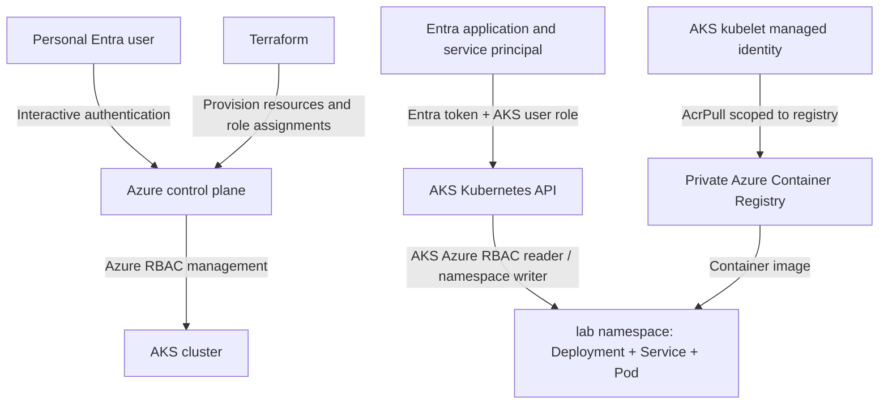

# Architecture and trust flows

**Authentication vs authorization:** Entra proves identity; Azure RBAC determines what that identity can do. The service principal operates against the Kubernetes API, whereas the kubelet managed identity pulls images from ACR. These are separate principals with least-privilege assignments.

**RBAC design:** The service principal receives AKS Cluster User for kubeconfig retrieval, AKS RBAC Reader at cluster scope, and AKS RBAC Writer at the `lab` namespace scope. The kubelet identity receives `AcrPull` at the registry scope. No blanket Owner or Cluster Admin grants are defined.
