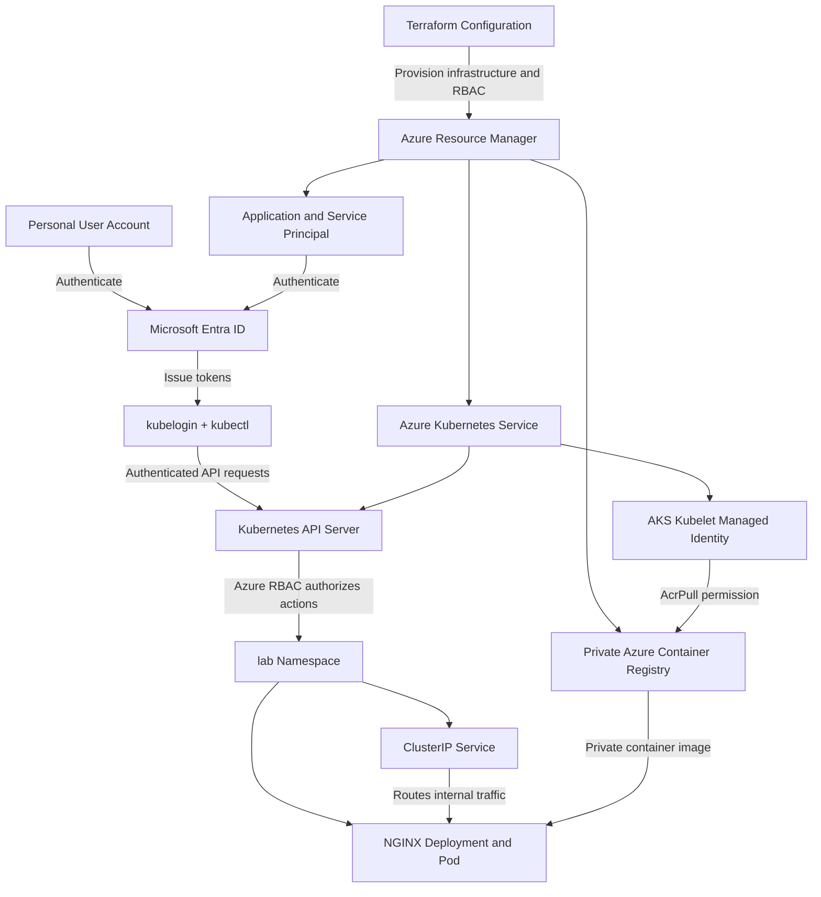

# Azure Kubernetes Identity and RBAC Architecture

## Architecture Diagram

## Authentication and Authorization

Microsoft Entra ID authenticates the personal user account and the application service principal. The kubelogin tool supports obtaining an Entra token for Kubernetes access.

Azure RBAC determines whether an authenticated identity can perform actions against the AKS Kubernetes API.

The deployment service principal receives:
- Azure Kubernetes Service Cluster User Role at AKS cluster scope.
- Azure Kubernetes Service RBAC Reader at cluster scope.
- Azure Kubernetes Service RBAC Writer scoped to the lab namespace.

The AKS kubelet managed identity receives AcrPull at the Azure Container Registry scope. This allows nodes to retrieve private container images without using registry administrator credentials.

## Least Privilege

The service principal does not receive Owner or Cluster Admin permissions. Write permissions are restricted to the lab namespace.

The kubelet identity has registry pull permission, not registry push or administrator access.

## Validation Status

Terraform initialization and validation succeeded locally.

The Kubernetes manifests passed offline YAML syntax checks.

Azure deployment, token-based authentication, image pulling, and RBAC authorization have not been tested because no Azure subscription is currently accessible.